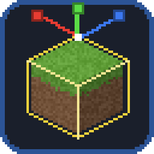
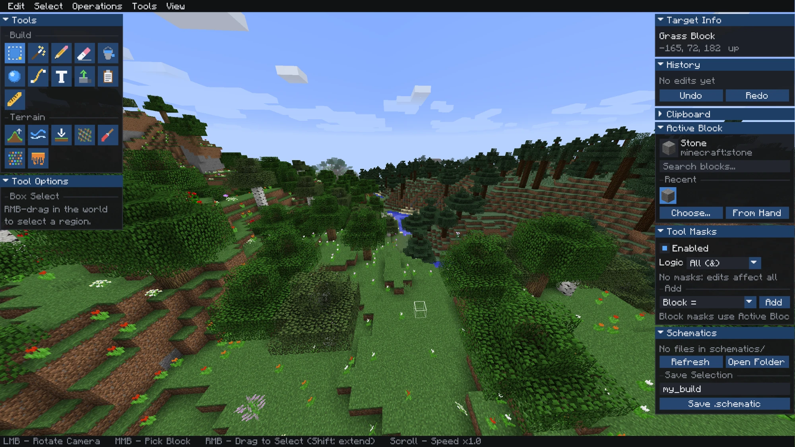
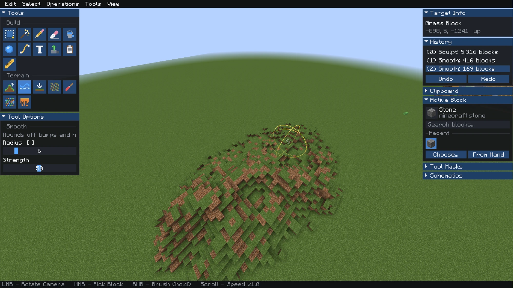
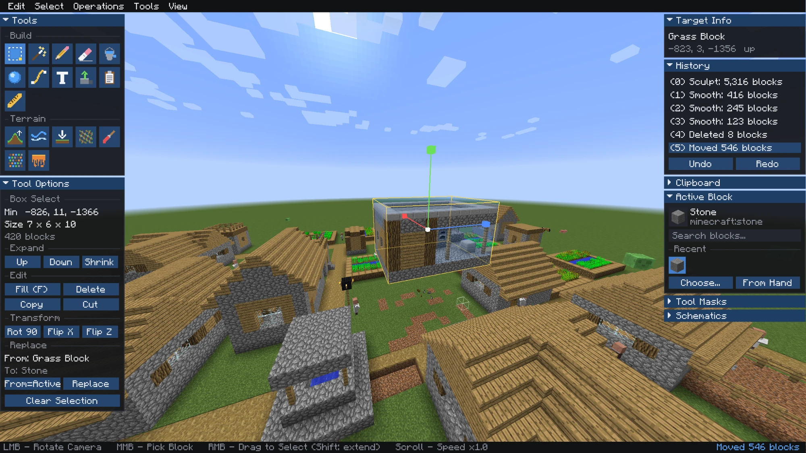
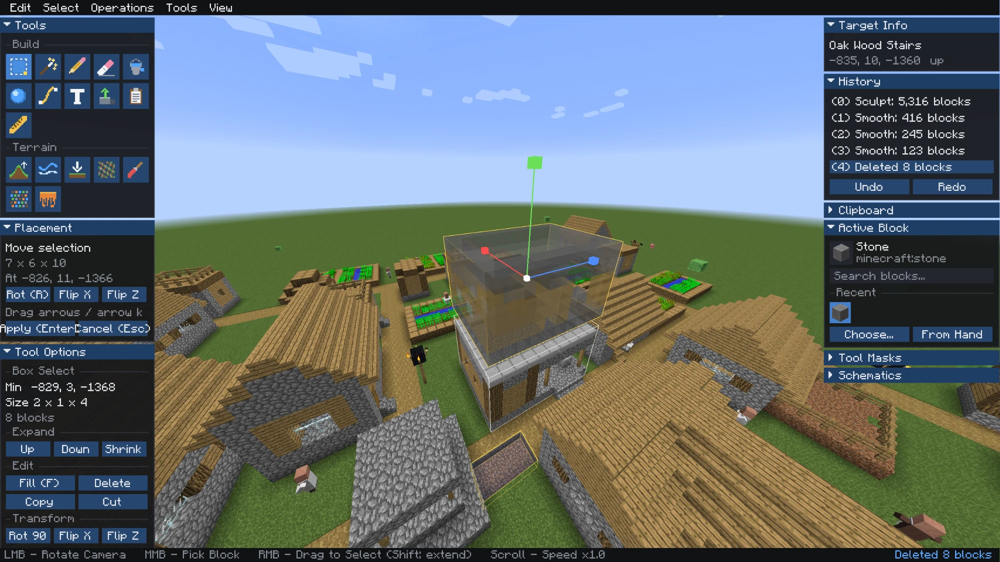

<p align="center"></p>

# Forma

**An in-game world editor for Minecraft 1.12.2 (Forge)**, by Kristihack.
Fly a free camera, select regions, sculpt terrain, place shapes and text, and move whole builds around, with full undo/redo. No commands to memorize.



## Features

- **Free-fly editor camera.** Press a key to leave your player behind and fly around the world with dockable panels.
- **Selections.** Box Select (Shift extends the box) and Magic Select (connected blocks), with expand, shrink, fill, delete, copy, cut, rotate, flip and replace.
- **Move with a gizmo.** Drag the axis arrows or use the arrow keys to move a selection, then confirm with Enter.
- **Build tools.** Pencil, Eraser, Bucket Fill, Create Shape (sphere, cube or cylinder, hollow or solid), Path, Text, Extrude, Paste and Ruler.
- **Terrain brushes.** Sculpt, Smooth, Flatten, Noise, Paint, Scatter and Melt/Grow, with adjustable radius and strength.
- **Tool masks.** Limit any edit with rules such as `Block =`, `Y =`, `In Selection`, `Above =`, `Below =`, `Near =`, `Solid` or `Air`. Masks can be combined with AND or OR logic.
- **History.** Undo and redo up to 50 edits. Each entry lists what changed and how many blocks it touched.
- **Schematics.** Save a selection as a `.schematic` and load `.schematic` (MCEdit / WorldEdit 6 / Schematica) or `.schem` (Sponge v1–v3) files.
- **Block picker.** Search every block, keep a list of recent blocks, or take the block from your hand.

## Screenshots

| Terrain brushes | Selection tools |
|---|---|
|  |  |



## Installation

1. Install **Minecraft Forge for 1.12.2**.
2. Put `Forma-1.12.2-0.3.0.jar` (from the [`release/`](release/) folder) into your `mods/` folder.
3. To play on a server, install the mod on the server too. Edits run on the server.

### Permissions

Editing requires **operator** permission. In singleplayer without cheats, the world owner can edit while in **Creative** mode.

## Controls

Press **Right Shift** to open or close the editor. You can rebind this under *Controls → Forma*.

### Camera

| Input | Action |
|---|---|
| Movement keys (WASD) | Fly |
| Jump / Sneak | Up / down |
| Sprint | Fly faster |
| Left mouse drag | Rotate camera |
| Scroll wheel | Change fly speed |
| Middle mouse | Pick the targeted block as the Active Block |
| Right mouse | Use the current tool |

### Keyboard shortcuts

| Key | Action |
|---|---|
| `1`–`9` | Switch tool |
| `Ctrl+Z` / `Ctrl+Shift+Z` / `Ctrl+Y` | Undo / redo |
| `Ctrl+C` / `Ctrl+X` / `Ctrl+V` | Copy / cut / paste |
| `Ctrl+D` | Clear selection |
| `F` | Fill selection with the Active Block |
| `Delete` / `Backspace` | Delete selection |
| Arrow keys, `Page Up` / `Page Down` | Nudge the selection or placement |
| `R` / `X` / `Z` | Rotate / flip X / flip Z while placing or pasting |
| `Enter` | Apply placement, or confirm the tool (e.g. place a Path) |
| `Esc` | Cancel |
| `[` / `]` | Shrink / grow brush radius |

## Tools

### Build

| Tool | Description |
|---|---|
| Box Select | Right-drag to select a cuboid region |
| Magic Select | Select connected blocks |
| Pencil | Place single blocks |
| Eraser | Remove blocks (drag) |
| Bucket Fill | Flood-fill an area |
| Create Shape | Sphere, cube or cylinder; hollow or solid; optionally sitting on the surface |
| Path | Click points, then press Enter to place a line through them |
| Text | Place block text, standing or flat, with scale and depth |
| Extrude | Push out or pull in a face |
| Paste | Place the clipboard |
| Ruler | Measure distances |

### Terrain

| Brush | Description |
|---|---|
| Sculpt | Raise or lower the surface |
| Smooth | Round off bumps and holes |
| Flatten | Level to the clicked height (cut and fill, cut only, or fill only) |
| Noise | Add rough natural detail |
| Paint | Paint surfaces with the Active Block |
| Scatter | Paint a random mix of recent blocks |
| Melt | Erode or grow edges |

## Schematics

Schematics are kept in `.minecraft/schematics/`. Use the **Schematics** panel to refresh the list, open the folder, or save the current selection under a name you choose.

## Limits

To keep servers safe, edits are capped at 8,000,000 blocks per operation. Shapes have a maximum radius of 64, brushes 32, and flood fills stop at 1,000,000 blocks.

## Building from source

The project uses [RetroFuturaGradle](https://github.com/GTNewHorizons/RetroFuturaGradle).

```bash
./gradlew build
```

The built jar is written to `build/libs/`. To start a development client, run:

```bash
./gradlew runClient
```

## Version

Current version: **0.3.0** for Minecraft **1.12.2**.

## Author

Made by **Kristihack**.

## License

Copyright © 2026 Kristihack. **All Rights Reserved.** See [LICENSE](LICENSE).
